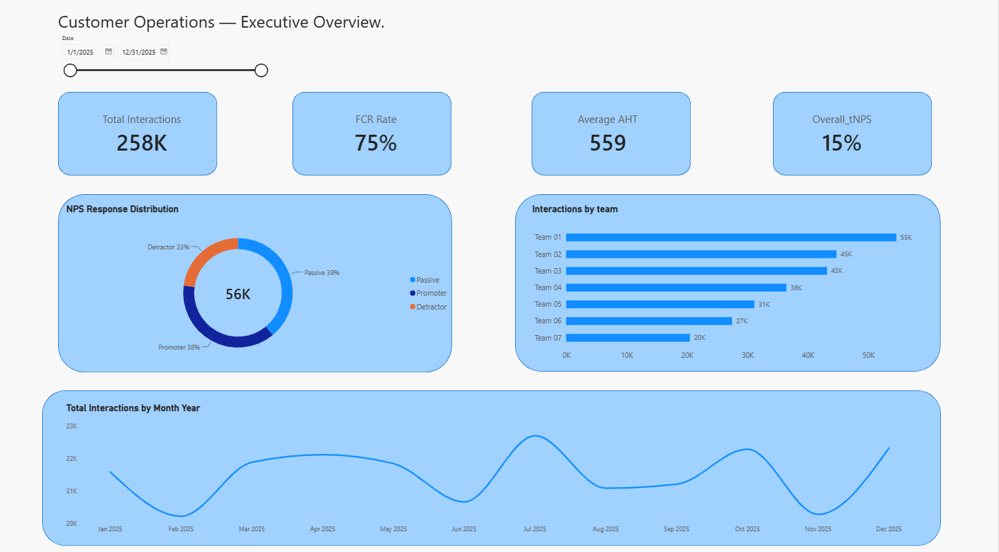
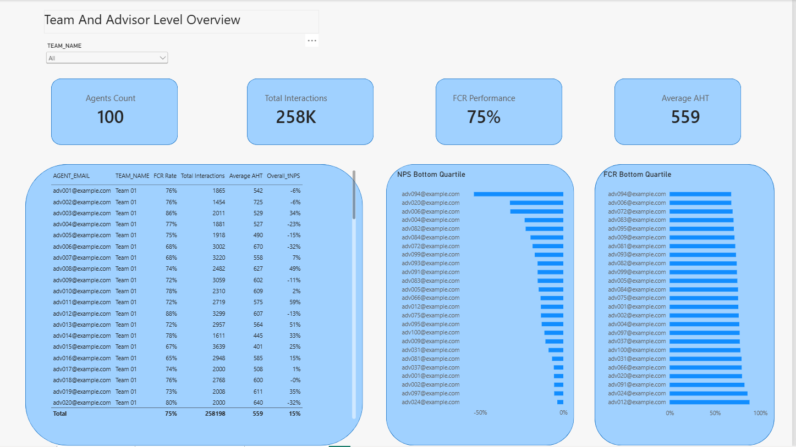
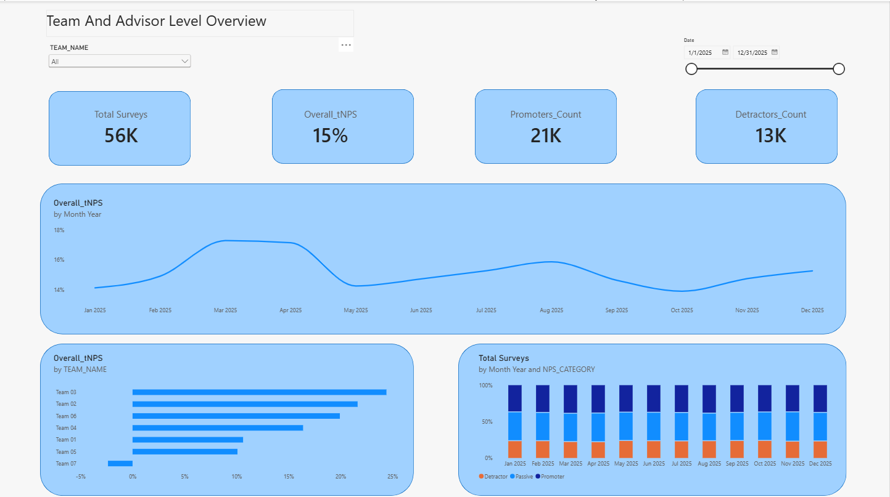

# Customer Operations Intelligence Platform

An end-to-end analytics engineering project that turns synthetic telecom customer-operations data into validated, business-ready performance insights.

The project demonstrates a data pipeline built with **Python, Snowflake, dbt, and Power BI**—from raw CSV ingestion and data-quality checks to dimensional reporting models and an interactive dashboard.

## Business objectives

The platform is designed to help operations leaders:

- Monitor **First Contact Resolution (FCR)** and Average Handling Time (AHT).
- Track customer experience through **Net Promoter Score (NPS)**.
- Compare advisor and team performance.
- Identify trends over time and advisors who may need operational support.
- Provide consistent metrics for management and performance reviews.

## Project status

The core pipeline and three-page Power BI dashboard are implemented.

| Component | Status |
|---|---|
| Python CSV extraction | Implemented |
| Python data validation | Implemented |
| Snowflake RAW loading | Implemented |
| dbt staging, intermediate, and marts | Implemented |
| dbt schema tests | Implemented |
| Power BI dashboard | Implemented |
| Apache Airflow orchestration | Not implemented; possible future enhancement |
| PostgreSQL integration | Not part of the current execution flow |

## Architecture

```text
Synthetic CSV datasets
        |
        v
Python ingestion pipeline
  - Extract
  - Validate
  - Load
        |
        v
Snowflake — RAW_AREA
        |
        v
dbt transformations
  - STAGING
  - INTERMEDIATE
  - MARTS
        |
        v
Power BI
  - Executive Overview
  - Advisor & Team Performance
  - Customer Experience
```

### Data flow

1. **Extract:** Python and pandas read the interaction, NPS survey, and advisor reference CSV files.
2. **Validate:** The pipeline checks required columns, missing values, unique keys, allowed values, numeric ranges, date coverage, and relationships between datasets.
3. **Load:** Validated data is loaded into Snowflake RAW tables. The loader writes to temporary staging tables and then replaces the target table contents within a transaction.
4. **Transform:** dbt builds staging views, intermediate models, and reporting marts.
5. **Analyze:** Power BI imports the marts and presents operational and customer-experience metrics.

The current Python entry point is `src/main.py`. The pipeline reads the CSV files from the `data/` directory and loads them into pre-created Snowflake RAW tables.

## Dataset

All records are **synthetic** and intended for learning and demonstration. They do not represent real customers, advisors, or company performance.

Coverage: **1 January 2025 – 31 December 2025**

| Dataset | Grain | Records |
|---|---|---:|
| Interactions | One row per customer interaction | 258,198 |
| NPS surveys | One row per submitted survey | 56,378 |
| Advisor reference | One row per advisor | 100 |

There are 7 teams. The survey response rate in the source dataset is approximately 21.8%.

### Source files

- `data/synthetic_interaction_records_2025.csv`
- `data/synthetic_nps_surveys_2025.csv`
- `data/synthetic_advisor_reference.csv`

See [the dataset notes](data/synthetic_dataset_README.txt) for column definitions, grain, and modeling considerations.

### Key relationships

- `interaction_id` links an NPS survey to its originating interaction.
- `agent_email` links interactions to the advisor reference and provides team attribution.
- Not every interaction has a submitted NPS survey.

## Data quality and validation

The Python pipeline stops before loading if a validation check fails.

Current checks include:

- Required columns exist in each dataset.
- Required fields contain no missing values.
- Interaction, survey, and advisor keys are unique.
- NPS surveys reference existing interactions.
- Interactions reference known advisors.
- Customer numbers agree between interaction and survey records.
- FCR values are restricted to `yes` and `no`.
- NPS scores are integers from 0 to 10.
- AHT values are positive integers.
- Interaction and survey dates fall within 2025.

Python validation functions are in `src/validate.py`, with automated tests in `tests/test_validate.py`.

## Snowflake and dbt transformations

Snowflake stores the ingested source data in:

- Database: `CUSTOMER_OPERATIONS_DB`
- Raw schema: `RAW_AREA`

dbt transforms the raw tables through three layers:

### STAGING

- `stg_interactions`
- `stg_nps_surveys`
- `stg_advisors`

The staging layer standardizes source fields, including converting the FCR yes/no field into a Boolean.

### INTERMEDIATE

- `int_interactions_with_advisors` — enriches interactions with advisor and team attributes.
- `int_interactions_with_nps` — joins interaction records to submitted NPS survey scores.

### MARTS

| Model | Grain | Purpose |
|---|---|---|
| `mart_interaction_performance` | One row per interaction | Interaction-level operational analysis |
| `mart_nps_performance` | One row per submitted survey | Survey and NPS-category analysis |
| `mart_advisor_performance` | One row per advisor | Aggregated advisor performance |

The advisor mart includes total interactions, FCR interactions and rate, average AHT, survey counts, promoters, detractors, and NPS.

### Metric definitions

- **FCR Rate:** FCR-resolved interactions divided by total interactions.
- **AHT:** Average handling time, stored in seconds.
- **NPS categories:** Promoters = scores 9–10; Passives = 7–8; Detractors = 0–6.
- **NPS:** `(Promoters - Detractors) / Total Surveys * 100`.

NPS is calculated from promoter and detractor counts, not by averaging individual NPS scores.

dbt model definitions and tests are maintained under `models/`. The project uses dbt schema tests, including uniqueness, not-null, relationship, accepted-value, and metric-range checks.

## Power BI dashboard

The Power BI report contains three pages:

### 1. Executive Overview

A high-level view of customer operations, including total interactions, FCR rate, average AHT, overall NPS, monthly interaction trends, NPS response distribution, and interactions by team.


### 2. Advisor & Team Performance

A performance view for comparing advisors and teams. It includes advisor-level metrics and focuses attention on the lowest-performing advisors by NPS and FCR.


### 3. Customer Experience

A customer-experience view showing survey volume, NPS, promoter and detractor counts, monthly NPS-category distribution, and NPS trends.


**Power BI file:** [Open the PBIX report](power_bi/customer_operations_insights.pbix)

The report uses the dbt marts as its analytical source. Its date and team filters are designed to work across the relevant report pages.

## Repository structure

```text
.
├── data/                 # Synthetic source datasets and dataset notes
├── models/
│   ├── staging/          # Source definitions and staging models
│   ├── intermediate/     # Joined and enriched models
│   ├── marts/            # Business-facing reporting models
│   └── schema.yml        # Model documentation and data tests
├── power_bi/
│   └── customer_operations_insights.pbix
├── src/
│   ├── extract.py        # CSV extraction
│   ├── validate.py       # Data-quality validation functions
│   ├── load.py           # Snowflake connection and loading logic
│   └── main.py           # Pipeline entry point
├── tests/
│   └── test_validate.py # Python validation tests
├── .env.example          # Environment-variable template
├── dbt_project.yml
├── requirements.txt
└── README.md
```

## Running the Python pipeline

### Prerequisites

- Python
- Access to a Snowflake account
- The target Snowflake database, RAW schema, and three RAW tables created with columns compatible with the source datasets

### 1. Clone the repository

```bash
git clone https://github.com/Thabet1/Customer_operations_insights_platform.git
cd Customer_operations_insights_platform
```

### 2. Create and activate a virtual environment

Windows PowerShell:

```powershell
python -m venv .venv
.venv\\Scripts\\Activate.ps1
```

### 3. Install dependencies

```bash
pip install -r requirements.txt
```

### 4. Configure Snowflake credentials

Copy `.env.example` to a new file named `.env` and fill in the Snowflake connection values:

```text
SNOWFLAKE_ACCOUNT=
SNOWFLAKE_USER=
SNOWFLAKE_PASSWORD=
SNOWFLAKE_WAREHOUSE=
SNOWFLAKE_DATABASE=
SNOWFLAKE_SCHEMA=
```

Keep `.env` private. Do not commit credentials to GitHub.

The current loader targets `CUSTOMER_OPERATIONS_DB.RAW_AREA` and expects the RAW tables `INTERACTIONS`, `NPS_SURVEYS`, and `ADVISORS` to exist.

### 5. Run the pipeline

From the repository root:

```bash
python src/main.py
```

The pipeline extracts the CSV files, runs its validation checks, and loads the datasets into Snowflake. It raises an error and stops if a validation check fails.

## Running tests

Run the Python validation tests from the repository root:

```bash
pytest
```

For dbt, connect the project to the appropriate Snowflake profile/target and run:

```bash
dbt build
```

The dbt build executes the selected models and their configured tests. The Power BI report should be refreshed after the marts have been rebuilt.

## Technologies

- **Python** — ingestion, validation, and orchestration of the local pipeline execution
- **pandas** — CSV extraction and dataframe handling
- **Snowflake** — cloud data warehouse and RAW storage
- **dbt** — SQL transformations, model organization, documentation, and testing
- **Power BI** — business intelligence and reporting
- **Git & GitHub** — version control and project hosting

## Future enhancements

- Add Apache Airflow to schedule and monitor pipeline execution.
- Add automated deployment and testing workflows for dbt changes.
- Expand monitoring for load failures, freshness, and data-quality trends.
- Add dashboard screenshots and a documented refresh procedure.

---

**Note:** This is a portfolio and learning project built with synthetic data. Credentials, live customer systems, and production deployment are not included.
